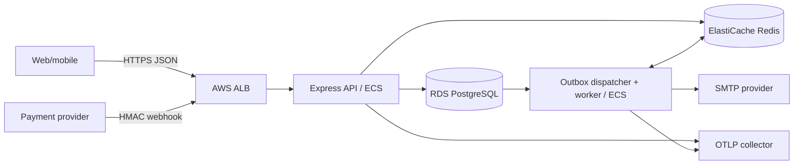
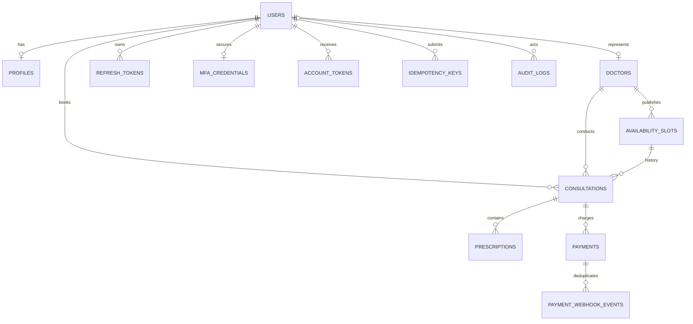

# Amrutam Backend Architecture Overview

This is the concise submission document. `architecture.md` is the extended engineering reference, while security controls and the STRIDE/OWASP analysis are in `security.md` and `threat-model.md`.

## System and code structure

Amrutam is a modular TypeScript service. The stateless Express API and asynchronous worker use the same image but separate ECS processes. PostgreSQL owns business state; Redis holds short-lived read cache entries and reconstructable BullMQ state.



Feature modules contain routes, controllers, services, repositories, schemas, and types. Controllers translate HTTP, services enforce policy and ownership, and repositories own SQL and transaction boundaries. `container.ts` explicitly constructs dependencies. Zod validates environment and API input; OpenAPI 3.1 documents `/api/v1`.

## Data model



Key invariants are unique normalized email, doctor user/licence, doctor/start-time slot, consultation/prescription version, user/idempotency key, one non-cancelled consultation per slot, and one pending or succeeded payment per consultation. Outbox events are logical aggregate references so one table can carry events for multiple domains. Audit metadata excludes clinical/profile values.

## Booking, consistency, and external workflows

```mermaid
sequenceDiagram
  actor Patient
  participant API
  participant DB as PostgreSQL
  participant Q as Redis/BullMQ
  participant W as Worker
  Patient->>API: POST /consultations + Idempotency-Key
  API->>DB: BEGIN; lock patient/key
  DB-->>API: replay stored result or continue
  API->>DB: require verified doctor + ACTIVE account
  API->>DB: claim future AVAILABLE slot conditionally
  API->>DB: insert consultation, audit, idempotency, outbox
  API->>DB: COMMIT
  API-->>Patient: 201 (or replay)
  W->>DB: poll pending outbox rows
  W->>Q: enqueue using outbox UUID
  Q-->>W: deliver with retry/backoff
  W->>DB: mark processed only after success
```

Booking uses a PostgreSQL transaction and row/advisory locks. A conditional slot update plus the partial unique index prevents double booking, while cancellation releases a future slot and permits a new consultation history row. Version predicates prevent lost consultation updates. Payment creation locks by consultation and has a matching partial unique index; provider event and payment locks make webhook replay deterministic. Real PostgreSQL integration tests exercise these races.

Local invariants commit in one database transaction. SMTP and a future real payment provider are external boundaries, so the outbox performs side effects after commit. Delivery is at least once: BullMQ defaults to five attempts with exponential backoff from one second, completed jobs remain for one day/10,000 entries, and failed jobs for seven days/50,000. PostgreSQL `processed_at` is the durable completion marker. Account, consultation, payment-status, and prescription-finalization events have concrete email handlers. A larger saga is unnecessary until a workflow spans independently owned services; business compensation is explicit cancellation, payment failure, or refund.

## Scale, caching, and partitioning

The API is horizontally scalable and all list endpoints are bounded. Indexes support doctor search, future availability, actor-scoped consultation history, payments, audit queries, and pending outbox scans. Performance acceptance tests encode p95 targets below 200 ms for reads and 500 ms for writes; results must be captured in the target environment rather than inferred from design.

Redis uses cache-aside only for public doctor reads. Search and profile results have 30-second TTLs; availability has 10 seconds. SHA-256 query hashes bound attacker-controlled key size. Generation counters invalidate doctor/slot changes, bookings, and cancellations without `KEYS` scans. Redis errors fail open to PostgreSQL, so cache state never decides booking correctness.

Start unpartitioned and measure. At sustained growth, range-partition `audit_logs` and processed `outbox_events` monthly so retention can detach old partitions. Archive completed consultations before partitioning them because global slot uniqueness must be redesigned around a partition key. Keep provider event IDs globally unique in an unpartitioned registry if webhook history is archived. Optimize queries/indexes, add connection pooling/read replicas, and archive before considering regional/patient sharding.

## Security and observability

Passwords use Argon2id. Access JWTs are short lived; opaque refresh tokens are hashed and rotated by family. Doctors/admins require TOTP MFA, with AES-256-GCM secrets and one-use recovery hashes. Route RBAC is followed by service-level ownership checks. Payment webhooks authenticate the raw body with timing-safe HMAC comparison. Recovery tokens are hashed, secrets come from environment/Secrets Manager, and the non-root image contains production dependencies only.

Express trusts zero proxy hops locally and exactly one ALB hop in ECS. Helmet, a 1 MB body limit, authentication throttling, strict schemas, generic errors, and redaction of authorization/cookie/API-key headers reduce the HTTP attack surface. The one-off admin bootstrap refuses implicit role promotion and still requires first-login MFA.

Pino request IDs correlate logs. Prometheus records route/status counts and duration behind a bearer token. OpenTelemetry instruments HTTP, Express, PostgreSQL, Redis, and worker spans without payloads. Local Jaeger/Prometheus/Grafana assets and an AWS CloudWatch dashboard cover API errors/latency, ECS, ALB, RDS, and Redis.

## AWS availability, delivery, and recovery

Terraform creates a two-AZ VPC, public ALB, private ECS/RDS/Redis, encrypted storage, ECR scan-on-push, Secrets Manager, logs, dashboard, and CPU scaling. Active API tasks require ACM TLS and an HTTPS public URL; SMTP and OTLP endpoints are variables. GitHub Actions uses OIDC, tests a commit, pushes an immutable SHA image, runs a separate-credential migration task, and then rolls out API and worker revisions.

Within-region targets are RPO 5 minutes and RTO 1 hour; they are objectives until restore drills prove them. Production uses Multi-AZ RDS with 14-day point-in-time backups, reviewed pre-release snapshots, immutable ECR images, and encrypted/versioned Terraform state. Redis is reconstructable from unprocessed PostgreSQL outbox rows. Recovery restores RDS to a new instance, rotates connection secrets, recreates Redis, runs migrations, starts one API/worker canary, verifies auth/booking/outbox/payment/audit integrity, then scales. Quarterly isolated restore drills record achieved RPO/RTO.

Current limits are explicit: payment checkout is fake, rate limiting is process-local, worker scaling is static, one NAT gateway is a regional dependency, and cross-region snapshot copy/DNS failover is not implemented. These are production-readiness decisions, not hidden correctness assumptions.
