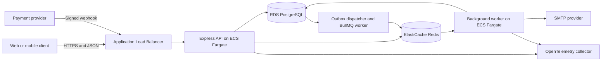
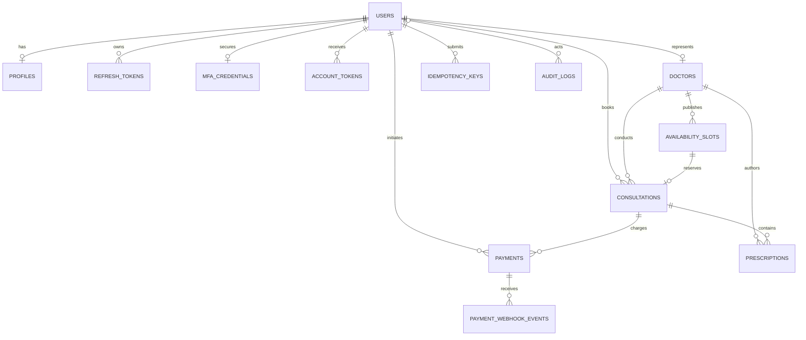
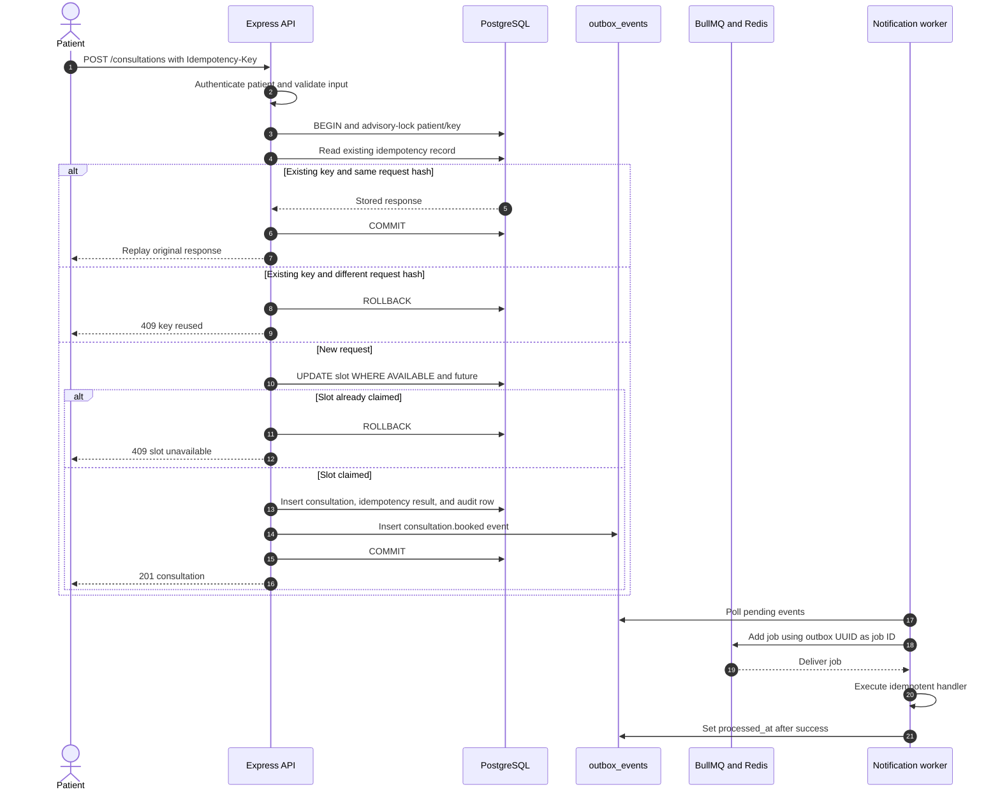

# Amrutam Backend Architecture

This document describes the implemented backend architecture, its runtime boundaries, critical data flows, reliability model, and AWS deployment topology. The system is a modular TypeScript application rather than a set of independently deployed microservices. The API and background worker use the same codebase and container image but run as separate processes.

For the assignment's 2-4 page version, use `architecture-overview.md`; this file is the extended engineering reference.

## System context

Amrutam supports patients, doctors, and administrators through a versioned REST API. PostgreSQL is the authoritative datastore. Redis and BullMQ coordinate asynchronous work but do not own business state.



## Runtime components

| Component | Responsibility | State |
|---|---|---|
| Express API | HTTP validation, authentication, authorization, orchestration and response mapping | Stateless between requests |
| PostgreSQL | Users, profiles, doctors, slots, consultations, prescriptions, payments, sessions, audit records, idempotency records and outbox events | System of record |
| Redis and BullMQ | Public doctor-read cache, queue state, job coordination, retry scheduling and worker concurrency | Cache/queue state is operational; pending jobs are reconstructable from PostgreSQL outbox rows |
| Outbox worker | Publishes pending database events, processes BullMQ jobs and marks successful events processed | Separate process using the same image |
| Email provider | Fake JSON transport locally or SMTP delivery in configured environments | External delivery system |
| OpenTelemetry | HTTP, Express, PostgreSQL, Redis and worker traces | Exported through OTLP when enabled |
| Prometheus and Grafana | Local metrics collection and provisioned operational dashboard | Local observability profile |
| AWS CloudWatch | ECS logs, Container Insights and infrastructure dashboard | AWS-managed telemetry |

## Code organization

The code uses feature modules with layered responsibilities:

```text
src/
├── common/                 shared errors and HTTP middleware
├── config/                 validated environment configuration
├── infrastructure/         database, notifications, observability and outbox
├── modules/
│   ├── auth/               authentication and MFA
│   ├── accounts/           recovery, verification and session management
│   ├── users/              account administration
│   ├── profiles/           personal information
│   ├── doctors/            onboarding, verification and availability
│   ├── consultations/      booking and lifecycle
│   ├── prescriptions/      draft and final prescriptions
│   ├── payments/           initiation, fake gateway and signed webhooks
│   ├── audit/              append-oriented audit query API
│   ├── analytics/          administrative aggregates
│   └── admin/              administrative workflows
├── openapi/                OpenAPI document and browser explorer
├── bootstrap-api.ts        telemetry-first API entry point
└── bootstrap-worker.ts     telemetry-first worker entry point
```

Controllers own HTTP translation, services own business policy, and repositories own persistence. Dependencies are explicitly constructed in `src/container.ts`; domain code does not depend on a framework container.

## Entity relationship model

The diagram includes both the core assignment entities and supporting security, delivery, and idempotency records. Solid relationships are database foreign keys. `outbox_events.aggregate_id` is deliberately a logical reference because an event can describe several aggregate types.



Every table has its own primary key. Important uniqueness rules are user email, doctor user/licence, `(doctor_id, starts_at)`, `(consultation_id, prescription_version)`, `(user_id, idempotency_key)`, one non-cancelled consultation per slot, and one pending/succeeded payment per consultation. `audit_logs.actor_id` is nullable and becomes null if its user is deleted; business-record relationships otherwise cascade or restrict according to the Drizzle schema.

## Data growth and partitioning

The current schema uses ordinary PostgreSQL tables and targeted indexes. That is the correct starting point: premature partitioning would complicate unique constraints, foreign keys, and migrations without improving a small dataset. At the stated target of 100,000 consultations per day, the following staged strategy applies:

| Data | Current approach | Scale trigger | Target approach |
|---|---|---|---|
| `audit_logs` | Index by entity and creation time | Index size or retention deletes affect write latency | Monthly range partitions on `created_at`; detach and archive expired partitions |
| `outbox_events` | Pending/creation-time index | Completed rows dominate scans or vacuum | Monthly range partitions; retain pending/current partitions and archive or delete processed partitions |
| `payment_webhook_events` | Provider event primary key | Multi-year provider-event history | Range partition by processing month if provider replay windows allow archival |
| `consultations` | Patient, doctor, and unique-slot indexes | Query plans or index size miss latency targets | First add read replicas and archival; partition only after redesigning the global unique-slot invariant to include the partition key |
| `prescriptions` and `payments` | Consultation indexes | Historic records dominate active queries | Archive by consultation completion period; partition only with measured benefit |

Operational queries must include bounded date ranges once a table is partitioned. Partition creation should run ahead of time, retention should detach rather than row-delete large historical ranges, and migration must be rehearsed on production-sized data. There is no tenant key, so tenant-based sharding is not appropriate. If one PostgreSQL writer eventually becomes the bottleneck, the preferred order is query/index optimization, connection pooling, read replicas for analytics, archival, then deliberate horizontal sharding by a stable patient or regional key.

PostgreSQL requires a partitioned table's primary key or unique constraint to contain the partition key. Consequently, the `audit_logs` and `outbox_events` migrations must change their keys to include `created_at` (neither ID is referenced by a database foreign key). `payment_webhook_events.id` is the global deduplication key, so that table must remain unpartitioned unless a separate unpartitioned event-ID registry preserves the same invariant.

## Request lifecycle

1. Express trusts no proxy locally and exactly one proxy hop on ECS, so ALB client addresses are honored without trusting arbitrary forwarded chains.
2. Helmet applies HTTP security headers and Express enforces a 1 MB JSON body limit.
3. Pino assigns or propagates an `x-request-id`, produces structured request logs, and redacts authorization, cookie, API-key, and set-cookie headers.
4. Metrics middleware records request count and duration.
5. Route-specific authentication verifies the JWT signature, issuer, audience, purpose and role claim.
6. Role middleware applies coarse RBAC; service and repository logic applies ownership and state-transition rules.
7. Zod schemas reject invalid bodies, parameters and queries.
8. Controllers return versioned JSON responses; centralized error handling prevents unexpected exception details from reaching clients.

## Identity and session flow

Password login verifies an Argon2id hash. Patients may receive a session immediately when MFA is not enabled. Doctors and administrators must complete TOTP MFA. Access tokens are short-lived bearer JWTs; refresh tokens are random opaque values stored as hashes in PostgreSQL and delivered in an HTTP-only, secure-in-production, SameSite Strict cookie.

Refresh rotation replaces the current token and preserves a token family so replay can revoke the family. Password changes, resets and account suspension revoke active refresh sessions. MFA setup secrets are encrypted with AES-256-GCM, recovery codes are stored as keyed hashes, and a previously used TOTP step cannot be replayed.

A one-off, environment-driven bootstrap CLI creates the first administrator idempotently, refuses implicit promotion of an existing non-admin account, and records the action. The administrator must still enroll in mandatory MFA on first login.

## Consultation booking consistency

Booking is a PostgreSQL transaction. It atomically:

1. Locks the caller and idempotency-key pair with a transaction-scoped advisory lock.
2. Replays the existing result or rejects a key reused for different input.
3. Conditionally changes one future slot from `AVAILABLE` to `BOOKED`.
4. Inserts the consultation, idempotency response, audit record and outbox event.

The conditional slot update and partial unique index allowing only one non-cancelled consultation per slot prevent double booking while permitting a cancelled future slot to be rebooked. Consultation transitions include a version predicate and increment, so two writers using the same version cannot both succeed. Real PostgreSQL concurrency tests cover these invariants.

### Booking sequence



### Transaction boundaries and sagas

All invariants owned by this service are committed in local PostgreSQL transactions. Booking writes the slot, consultation, audit record, idempotency response, and outbox event atomically. Consultation status and payment webhook processing likewise update domain state and record audit/outbox data in one transaction.

The system does not currently need a distributed database transaction or a general saga orchestrator. SMTP and payment providers are external boundaries: database state commits first, then an outbox job performs the external side effect. Failures retry without rolling back an already accepted booking. Business compensation is explicit—cancel a consultation, release a future slot, fail or refund a payment—rather than an implicit technical rollback. A real payment gateway should add a persisted checkout/reconciliation state machine; introduce a saga coordinator only if one workflow spans multiple independently owned services with several compensating steps.

## Transactional outbox and jobs

Business transactions write domain events to `outbox_events`. The dispatcher selects rows where `processed_at IS NULL` and attempts remain, then creates a BullMQ job whose ID equals the outbox UUID. Repeated polling therefore converges on the same queue job.

The worker invokes the event handler before setting `processed_at`. Handler failures increment the database attempt count and are rethrown so BullMQ applies exponential retry. This is at-least-once processing: handlers must tolerate repetition because a process can complete an external side effect and fail before recording completion.

Account recovery, email verification, consultation booking/status, payment status, and finalized-prescription events use concrete email notification handlers. Unknown event types fall back to structured operational logging. Notifications contain links and lifecycle status only; clinical content is not copied into email.

### Retry and backoff policy

| Operation | Retry owner | Implemented policy | Terminal handling |
|---|---|---|---|
| Idempotent API write | Client | Repeat the same request with the same key; the stored response is replayed | Different payload with the same key returns 409 |
| Outbox polling | Worker | Poll every 1 second by default, maximum 100 pending rows per batch | Rows at the database attempt limit stop being selected and require operator review |
| BullMQ job | BullMQ | Five attempts by default with exponential backoff starting at 1 second | Failed jobs retained for seven days or 50,000 records |
| Completed BullMQ job | BullMQ | No retry; retained for one day or 10,000 records to preserve deduplication | PostgreSQL `processed_at` remains the durable completion marker |
| SMTP/account email | BullMQ worker | Provider error fails the job and uses the BullMQ policy | Alert, inspect, and replay only after confirming idempotency |
| Payment webhook | Payment provider | Provider retry schedule is external; event ID and payload hash make receipt idempotent | Conflicting reuse returns 409 and is investigated |
| PostgreSQL query | Application | No blind automatic retry | Surface transient failure; retry only the complete idempotent transaction |

Retry jitter is not currently configured. Before running many workers, add jitter or provider-aware `Retry-After` handling to avoid synchronized retry bursts.

## Payment processing

Payment initiation is patient-only and idempotent. Amount and currency are derived from server-owned doctor pricing rather than request input. Provider webhooks authenticate the exact raw request body with HMAC-SHA256, store provider event IDs and payload hashes, and enforce allowed payment transitions.

The current checkout implementation is a fake gateway. The webhook contract and persistence boundaries are ready for a real provider, but gateway-specific checkout creation, refund calls and reconciliation are not implemented.

## Redis caching strategy

Redis supports BullMQ and a separate cache-aside namespace for public doctor reads. PostgreSQL remains authoritative. The cache adapter treats read, write, and invalidation errors as misses, so a Redis outage degrades to database reads rather than an API outage.

| Read model | Key shape | TTL | Invalidation |
|---|---|---:|---|
| Verified-doctor list/search | `amrutam:cache:v1` prefix plus list generation and normalized-query hash | 30 seconds | Increment the list generation after doctor creation, update, or verification; cross-module profile/status changes age out at the TTL |
| Verified-doctor details | `amrutam:cache:v1` prefix plus doctor ID and profile generation | 30 seconds | Increment that doctor's profile generation after doctor updates; profile-name changes age out at the TTL |
| Public availability | `amrutam:cache:v1` prefix plus availability generation, doctor ID, and query hash | 10 seconds | Increment the availability generation after slot changes and successful booking or cancellation |

Query inputs are normalized, SHA-256 hashed, base64url encoded, and truncated, which keeps attacker-controlled keys bounded. Generation increments avoid `KEYS`/`SCAN`; entries from an old generation expire naturally. Cache only public response DTOs, never passwords, tokens, MFA material, prescription content, or unrestricted personal profiles. Distributed locks are unnecessary for correctness because all writes continue to PostgreSQL and stale reads are bounded by the short TTL. Metrics should track hit rate, fallback latency, invalidation errors, and Redis availability before TTLs are increased.

## Observability

Every request has a correlation ID. Prometheus metrics expose request count, status, route, duration and process uptime behind a bearer token. OpenTelemetry is initialized before instrumented libraries and exports traces over OTLP/HTTP when enabled. Worker spans include event and aggregate identifiers but exclude payloads and tokens.

The local observability profile provides an OpenTelemetry Collector, Jaeger, Prometheus and a provisioned Grafana dashboard. AWS deployment enables CloudWatch Logs, ECS Container Insights and a dashboard covering ECS, ALB, RDS and Redis.

## AWS deployment topology

Terraform creates two public and two private subnets across two availability zones. The ALB is public. ECS tasks, RDS and ElastiCache have no public IP addresses. Security groups allow API traffic only from the ALB and data-store traffic only from ECS tasks. Private tasks use a NAT gateway for ECR, SMTP and other outbound dependencies. Enabling API tasks requires an ACM certificate and an HTTPS public URL; HTTP is infrastructure-bootstrap only.

API, worker, and one-off migration processes use separate Fargate task definitions and log groups while sharing one immutable ECR image. The migration task receives a separate database credential and runs before service rollout. API tasks register with an IP target group and can scale on average CPU. Production options include an ACM certificate, Multi-AZ RDS, Redis replication and deletion protection.

Terraform creates the Secrets Manager container but not its secret value. Operators populate application secrets outside Terraform to keep values out of configuration and state. Desired task counts default to zero to support a safe two-stage bootstrap. SMTP and OTLP endpoints are variable-driven, with SMTP credentials read from Secrets Manager. The manual GitHub Actions deployment uses OIDC credentials, publishes a commit-SHA image, runs and verifies migrations, then rolls out the API and worker and waits for stability.

## Availability and recovery

The API is horizontally scalable because request state is external. PostgreSQL remains a single consistency boundary. Production configuration should use Multi-AZ RDS and at least two Redis nodes. RDS automated backup retention is 14 days in the production Terraform configuration and three days otherwise.

Recovery objectives are operational targets, not guarantees. The proposed within-region targets are an RPO of five minutes and RTO of one hour. After cross-region backup copying and failover automation are implemented, the proposed regional-disaster targets are an RPO of 24 hours and RTO of four hours. The current single-region deployment has no bounded regional RPO or RTO. Targets become commitments only after timed restore exercises pass.

### Backup policy

| Asset | Backup or reconstruction source | Retention target | Protection |
|---|---|---:|---|
| PostgreSQL | RDS automated backups and point-in-time recovery; pre-release manual snapshot | 14 days production plus policy-approved monthly archives | Encrypted, private, and access-audited |
| Redis/BullMQ | ElastiCache snapshot where enabled; pending jobs reconstructed from PostgreSQL outbox | Seven days is sufficient for operational recovery | TLS, encrypted storage, and private subnet |
| Container image | Immutable ECR digest | Last 30 images under the current lifecycle policy | Scan on push and restricted push rights |
| Infrastructure | Git-reviewed Terraform plus encrypted/versioned S3 state | Full repository and state history | S3 versioning, lockfile, and least-privilege IAM |
| Application secrets | Secrets Manager versions and provider-side recovery procedures | Per rotation policy | KMS encryption and audited reads |
| Audit records | Database backup plus immutable export when policy requires | Set by legal/privacy policy | Separate account or Object Lock target |

### Recovery runbook

1. Declare the incident, stop destructive automation, and record the recovery point and affected region.
2. Restore RDS to a new instance from the newest verified point before corruption; never overwrite the failed instance during investigation.
3. Apply security groups, create the least-privilege application credential, and update the Secrets Manager `DATABASE_URL`.
4. Provision or replace Redis. Allow the outbox dispatcher to reconstruct unfinished jobs from rows whose `processed_at` is null.
5. Select a previously verified immutable ECR image and apply Terraform/ECS task definitions with desired counts initially at zero.
6. Run database migrations as a controlled one-off task, then start one API and worker canary.
7. Verify liveness, readiness, login, booking invariants, outbox lag, payment state, and audit continuity before scaling normally.
8. Reconcile provider events and potentially duplicated external side effects using event and idempotency identifiers.
9. Preserve the failed environment for investigation, communicate recovery status, and complete a timed post-incident review.

At least quarterly in production, restore a snapshot into an isolated environment, run integrity and application smoke tests, measure actual RPO/RTO, and delete the exercise environment. Cross-region recovery is currently a documented gap: production readiness requires cross-region snapshot copy or replication, a second-region Terraform variable set, DNS failover procedures, and verified regional secret availability.

## Architectural constraints and next steps

- Payment processing uses a fake gateway.
- API rate limiting is process-local rather than shared across ECS tasks.
- Worker scaling is static; queue-depth autoscaling is not implemented.
- One NAT gateway keeps development costs lower but is an availability dependency.
- Cross-region disaster recovery and automated restore testing are not implemented.

