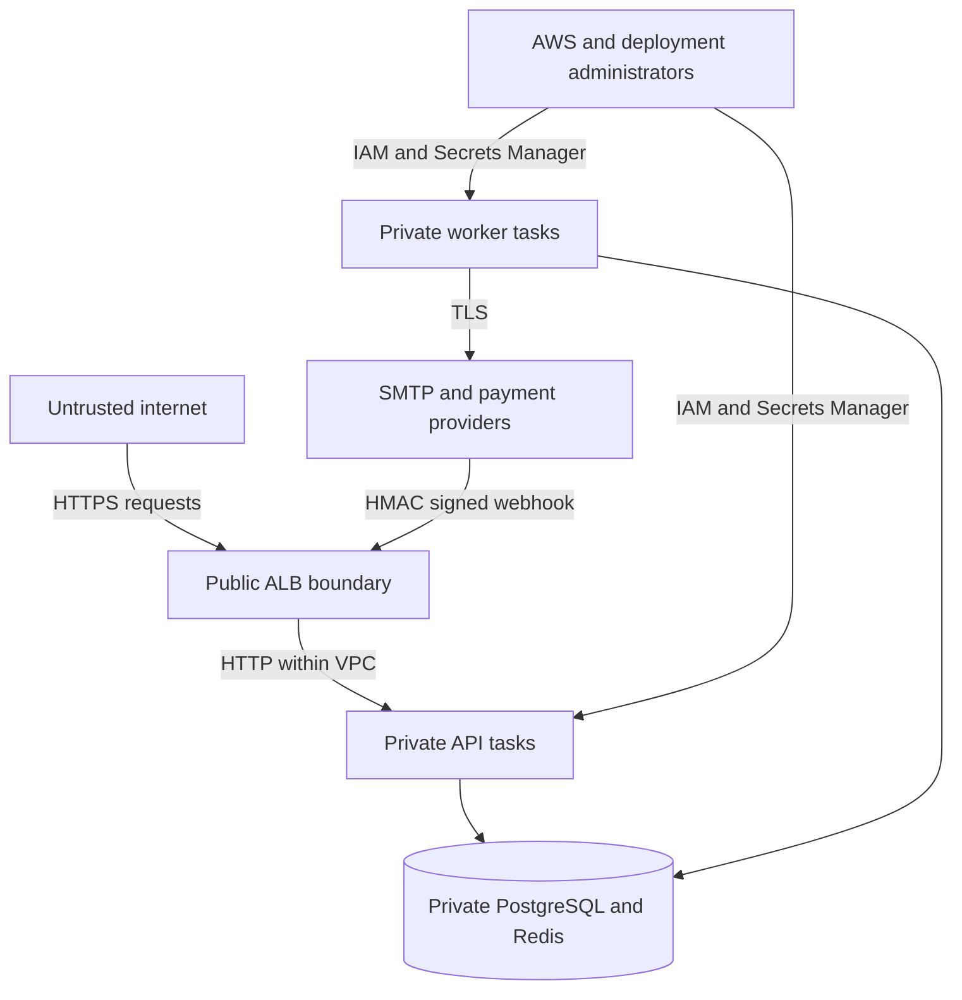

# Amrutam Backend Security Model

This document records the current security posture, trust boundaries, implemented controls, operational requirements and known risks. It is an engineering security baseline, not a claim of HIPAA, ISO 27001, SOC 2 or other regulatory compliance.

## Protected assets

The system handles credentials, session tokens, MFA secrets, personal profiles, consultation data, prescriptions, payment metadata and administrative audit records. The most sensitive assets are raw passwords, refresh tokens, recovery tokens, MFA secrets, clinical content and infrastructure credentials.

Raw passwords are never stored. Raw refresh and account-recovery tokens are not persisted. MFA secrets must be decrypted to validate TOTP codes, so protection of `MFA_ENCRYPTION_KEY` is critical. Prescription and consultation content remains readable by the application and therefore depends on database, network, IAM and operational controls.

## Trust boundaries

Data from clients, payment providers, email providers and queue payloads is untrusted. Database rows are trusted only after schema, authorization and state checks; direct database access remains privileged and can bypass application controls.

## Authentication controls

- Passwords use Argon2id through the `argon2` package.
- Authentication endpoints have a 20-request limit per 15-minute window per limiter key.
- JWT verification pins HS256 and validates issuer, audience, expiry, purpose and role.
- Access-token lifetime defaults to 15 minutes and is capped at one hour by configuration validation.
- Refresh tokens contain 48 random bytes, are stored as SHA-256 hashes and rotate on refresh.
- Refresh cookies are HTTP-only, SameSite Strict, scoped to `/api/v1/auth`, and Secure in production.
- Password reset and email verification use 48-byte random tokens stored only as hashes with explicit expiry and single-use state.
- Doctors and administrators must use MFA; patients may enable it.
- TOTP secrets use AES-256-GCM encryption, recovery codes are stored as keyed hashes, and used time steps cannot be replayed.
- Password changes and resets revoke all refresh sessions.

The JWT signing model uses one symmetric secret without key identifiers or overlapping rotation. Access tokens are not checked against account status on every request, so suspension takes full effect for bearer access when the short-lived access token expires, although refresh sessions are revoked immediately.

## Authorization controls

Route middleware enforces role-level access for patient, doctor and administrator operations. Services enforce resource ownership and workflow constraints, including assigned-doctor prescription changes, patient-owned cancellation and participant-only consultation and payment visibility.

Roles cannot be changed through general profile endpoints. Doctor self-service routes derive ownership from the authenticated user rather than accepting a caller-selected doctor identifier. Administrative endpoints require the `ADMIN` role.

Authorization tests cover representative cross-user and cross-role failures, but the project does not yet maintain a formal endpoint-by-role access-control matrix as an executable test.

## Input and HTTP security

- Zod schemas validate and bound request bodies, route parameters and query parameters.
- JSON bodies are limited to 1 MB.
- Helmet provides standard security response headers and hides framework identification.
- Errors use stable codes and request IDs; unexpected exceptions return a generic message.
- SQL is generated through Drizzle ORM, with raw SQL limited to parameterized advisory-lock and arithmetic expressions.
- Payment webhook signatures use HMAC-SHA256 over the raw body and timing-safe comparison.
- Idempotency keys bind to a request hash and expire after 24 hours.
- Fake payment mutation routes return 404 in production.

CORS is not enabled. Browser clients must therefore use the same origin or an explicitly designed reverse-proxy arrangement. Refresh-cookie operations rely on SameSite Strict and do not use a separate CSRF token. If cross-site browser flows are introduced, CORS and CSRF design must be revisited together.

## Data protection

AWS Terraform enables encrypted RDS storage, encrypted ElastiCache storage and Redis transit encryption. RDS and Redis are private and accept traffic only from the ECS security group. ECS tasks have no public IP addresses.

Secrets are injected from AWS Secrets Manager through the ECS execution role. Terraform creates no secret version, preventing application secret values from entering Terraform configuration and state. IAM access is limited to the application secret ARN. ECS task and execution roles are separate.

Application-level encryption currently covers MFA and account-delivery tokens, not all profile or clinical columns. Fine-grained database roles, column-level encryption, data retention and deletion policies must be defined before handling regulated production data.

## Queue and notification security

The outbox stores encrypted account tokens rather than plaintext values. The account worker resolves the recipient from PostgreSQL and decrypts the token only when constructing the email. Logs and OpenTelemetry attributes omit message bodies, tokens and payloads.

BullMQ provides at-least-once handling. The outbox UUID becomes the queue job ID, limiting duplicate queue entries while the job exists. External providers should also accept an idempotency key because a crash after delivery and before `processed_at` is recorded can cause a retry.

SMTP delivery should use `smtps://` or STARTTLS with authenticated provider credentials. The fake transport must not be enabled in production where account recovery is expected to work.

## Infrastructure controls

- Only ALB ports 80 and 443 are internet-accessible.
- ECS, RDS and Redis are placed in private subnets.
- ALB-to-ECS, ECS-to-PostgreSQL and ECS-to-Redis paths are security-group restricted.
- ECR uses immutable image tags, scan-on-push and lifecycle retention.
- Containers run as the non-root `node` user.
- ECS Exec is IAM-controlled through Systems Manager channels.
- RDS storage encryption, automated backups, optional Multi-AZ and deletion protection are configurable.
- ElastiCache uses storage and transit encryption; production enables replication and failover.
- Terraform state supports encrypted S3 storage, versioning and native S3 lockfiles.

Terraform permits an absent ACM certificate only while the API desired count is zero for infrastructure bootstrap. Enabling API tasks requires both a certificate and an HTTPS public URL, and the HTTP listener then redirects to HTTPS. AWS WAF, Shield Advanced, VPC endpoints, private NAT redundancy and egress filtering are not currently provisioned.

As of 26 October 2026, `npm audit --omit=dev --audit-level=high` reports zero production vulnerabilities. A full development audit reports four moderate findings rooted in the deprecated esbuild loader bundled by Drizzle Kit; the advisory concerns exposing an esbuild development server, which this project does not run. npm's proposed forced fix is a breaking Drizzle Kit downgrade, so this is an explicitly accepted development-only risk pending an upstream update, not a reason to weaken the production audit gate.

## Logging, audit and monitoring

Application logs are structured and correlated by request ID. Audit records cover security- and business-relevant changes without copying sensitive profile fields. There are no public audit mutation endpoints, but append-only behavior is not enforced against the database owner.

Metrics require a separate bearer token. OpenTelemetry traces contain route, database, Redis and safe outbox identifiers. CloudWatch log retention is configurable and defaults to 30 days. Access to logs, traces and dashboards must be restricted because identifiers and error context can still be sensitive.

The project does not yet define alert routing or incident escalation. Minimum production alerts should cover elevated 5xx rate, latency, unhealthy ALB targets, ECS task churn, RDS storage and connections, Redis memory and evictions, BullMQ failures, exhausted outbox attempts and backup failure.

## Threats and mitigations

| Threat | Current mitigation | Residual risk |
|---|---|---|
| Credential stuffing | Argon2id and authentication rate limits | Limiter is process-local and needs shared/global enforcement |
| Token theft | Short access lifetime, hashed rotating refresh tokens, secure cookie | Bearer access tokens remain usable until expiry |
| Privilege escalation | JWT claim validation, RBAC and ownership checks | Authorization matrix is not exhaustively tested |
| Double booking | Conditional slot claim, unique index and PostgreSQL transaction | Operational database bypass remains privileged |
| Duplicate financial action | Idempotency records and provider-event deduplication | Real gateway integration and reconciliation are pending |
| Forged webhook | Raw-body HMAC and timing-safe comparison | Secret rotation procedure is not implemented |
| Queue message loss | Transactional outbox and retries | Poison events require an operational quarantine process |
| Sensitive logging | Generic client errors, sanitized notification/trace metadata, and tested authorization/cookie/API-key header redaction | New dependency serializers or secret-bearing fields require redaction review |
| Database compromise | Private networking and encryption at rest | Broad application database credentials can expose all rows |
| Infrastructure takeover | IAM roles, private tasks and external secret population | CI deployment identity and account guardrails are not yet defined |

## Secure operations requirements

Before production activation:

1. Supply an ACM certificate and approved domain, then verify the enforced HTTPS deployment path.
2. Use separate AWS accounts for development, staging and production.
3. Use GitHub OIDC or another short-lived deployment identity rather than static AWS keys.
4. Populate Secrets Manager with independently generated secrets and document rotation.
5. Create a least-privilege application database role instead of using the RDS administrator.
6. Run migrations as an explicit, auditable deployment step before service rollout.
7. Replace the fake payment gateway and fake email mode with reviewed providers.
8. Move authentication throttling to a shared store or edge control; ECS already uses a bounded one-hop ALB trust setting.
9. Add WAF rules, alarms, dependency scanning, container scanning enforcement and centralized alert routing.
10. Test database restore, image rollback, secret rotation and queue recovery.
11. Define data classification, consent, retention, deletion, residency and breach-response policies.
12. Complete an independent penetration test and compliance assessment appropriate to the jurisdictions served.

## Known security gaps

The following are intentionally documented rather than implied to be complete:

- No shared distributed rate limiter or account lockout policy.
- No asymmetric JWT signing, key ID or automated signing-key rotation.
- No per-request database check for user suspension.
- No AWS WAF or explicit egress allowlist.
- No production payment gateway or reconciliation job.
- No notification delivery ledger or dead-letter administration endpoint.
- No enforced immutable audit storage.
- No automated secret rotation.
- No field-level encryption for clinical or profile data.
- No tested disaster-recovery runbook or cross-region recovery.
- No formal healthcare compliance certification.

The detailed attack-surface inventory, data-classification scheme, STRIDE analysis, OWASP API Security Top 10 mapping, rotation runbooks, supply-chain controls, audit-retention requirements, incident notes and production gate are maintained in [Threat Model and Security Checklist](./threat-model.md).

